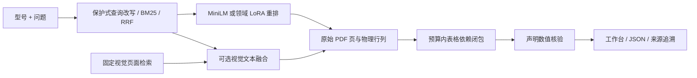

# ChipClaw · 条件感知的芯片手册检索与证据核验

面向芯片数据手册的技术文档 RAG 研究项目。从本科毕业设计持续迭代，围绕一个具体问题：**模型找到正确的数字后，怎样避免把典型值、最大值和测试条件配错？**

**Python · PyTorch · FastAPI · 多语言 MiniLMv2 · Qwen3-Reranker LoRA · 视觉 / 文本融合**

## 先体验

```bash
git clone https://github.com/l422145205-source/chipclaw.git
cd chipclaw
python -m venv .venv
# Windows: .venv\Scripts\activate
# Linux/macOS: source .venv/bin/activate
python -m pip install -r requirements-web.txt
python -m uvicorn chipclaw.workbench:app --host 127.0.0.1 --port 8000
```

打开 **http://127.0.0.1:8000**。无需 GPU、模型下载或 API Key；默认展示 **28 条保存的真实运行**，覆盖 20 份手册。历史回放不执行新的检索，也不冒充在线回答。

也可运行 `python -m http.server 8000 --directory web`，直接体验静态回放界面。

### 工作台能做什么

- 选择芯片与问题，在完整环境中调用 `/evidence` 实时检索。
- 在预算内查看入选的原始片段，保留物理行列、表头、单位和上下文；跳转官方 PDF 来源页。
- 输入数值声明，查看“支持 / 冲突 / 未判定”，并定位到匹配的原文行。
- 导出本次请求及结果 JSON；查看来源 SHA-256、页码和原始字符区间。
- 切换真实记录、实验结果与复现说明；适配手机与桌面。

## 核心技术

1. **条件冲突难负例与排序训练**：构建 1,578 个语义意图 / 3,156 个中英问题形式，其中 423 个涉及条件或角色冲突。对多语言 MiniLMv2 全参数微调，比较等步数、等采样的无 KL / KL 蒸馏对照；对 Qwen3-Reranker-0.6B 进行领域 LoRA，直接以 yes-minus-no logits 训练排序损失。
2. **多视角召回与可选择的重排路径**：保护型号、数值和单位的查询改写，BM25 多视角 RRF；学生排序、领域 LoRA 与固定视觉子集融合分别提供可测量的选择。保守门控未通过校准，当前回退学生模型。
3. **预算内的表格依赖闭包**：从原始 PDF 物理行列构建连续证据区间，保留数值对应的表头、单位和上下文，多起点选择满足字符与页面预算；不把参考答案写回证据。
4. **独立数值核验**：从物理表格绑定参数、值、单位、MIN/TYP/MAX 与条件，执行确定性匹配，输出三态结果。核验范围受规则解析能力限制。



## 实验结果

语料：**20 份官方手册、1,822 页、10,668 个片段**；视觉实验覆盖固定 240 页。

| 受控排序：复用留出集 1,042 个双语问题形式 | MRR@10 | Top-1 |
|---|---:|---:|
| 多语言 MiniLMv2 基座 | 0.8694 | 819 / 1042 |
| 全参数微调，无 KL（dev 选定） | **0.9606** | 976 / 1042 |
| 全参数微调，KL 对照 | 0.9579 | 974 / 1042 |
| Qwen3 领域 LoRA 排序 | **0.9686** | 988 / 1042 |

| 实际全文召回候选：240 个问题形式，同文档 16 候选 | 来源页 MRR | 平均重排耗时 |
|---|---:|---:|
| 多语言学生 | 0.8973 | 14.7 ms |
| 全候选领域 LoRA | 0.9531 | 355.9 ms |

以上耗时来自原实验设备，不是端到端耗时或在线服务承诺。受控候选排序与真实召回候选是不同实验，不直接横向混比。完整配置与冻结摘要见 [experiments](experiments)。

**必须一起读的边界**：标签为来源约束的弱标签 / 模板问题；留出集已复用；独立人工事实金标准为 0。MRR 不是生成问答准确率。LoRA 是排序训练，不是生成回答 SFT；视觉模型使用公开权重，没有训练 VLM。门控关闭的负结果也保留在报告中。

## 代码入口

| 模块 | 入口 |
|---|---|
| 轻量工作台 | `chipclaw/workbench.py`、`web/` |
| 实时 API / 原有生成 API | `chipclaw/api.py`：`/evidence`、`/ask` |
| v4 检索与级联 | `chipclaw/retrieval_v4.py`、`chipclaw/cascade_v4.py` |
| 物理表格 / 预算选择 | `chipclaw/geometry*.py`、`chipclaw/packets_v4.py` |
| 独立数值核验 | `chipclaw/fact_verifier.py` |
| MiniLM / LoRA 训练 | `scripts/train_multilingual_v4.py`、`scripts/train_domain_lora_v4.py` |

## 复现与项目状态

- [公开版本的资源与复现说明](PUBLICATION.md)：轻量体验、数据、训练、实时接口的不同前提。
- [实验索引](experiments/README.md)：冻结结果、模型选择和门控的证据路径。
- [第三方来源](THIRD_PARTY.md)：官方手册及模型来源。

当前定位是**有真实实验和可运行界面的研究 / 求职项目**。仍需独立人工评测、完整回答质量验证、权限与并发服务治理，才适合称为生产级服务。

公开仓库不包含个人简历、原始毕业论文、账号配置、环境缓存或大体积训练权重。原始 PDF 由官方链接下载；可追溯的少量检索片段用于方法说明与结果复核。

公开版本在完整本地依赖环境中通过 **213 项测试**；轻量 GitHub CI 只运行无需模型的工作台数据契约测试。
